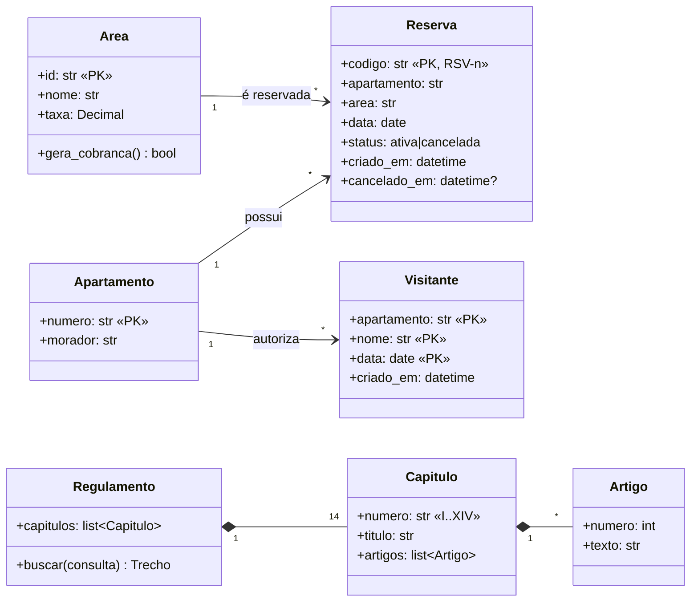
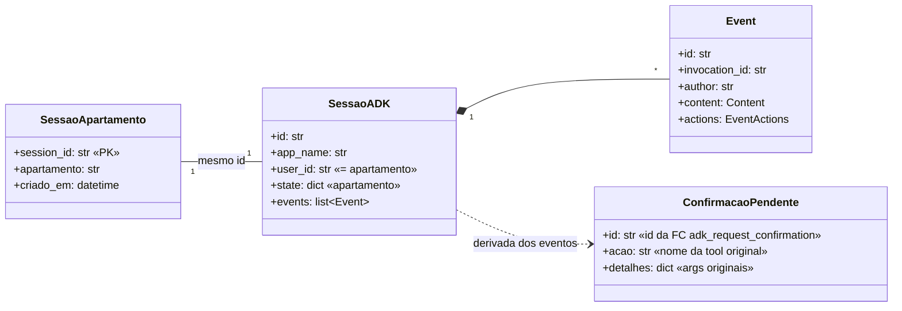
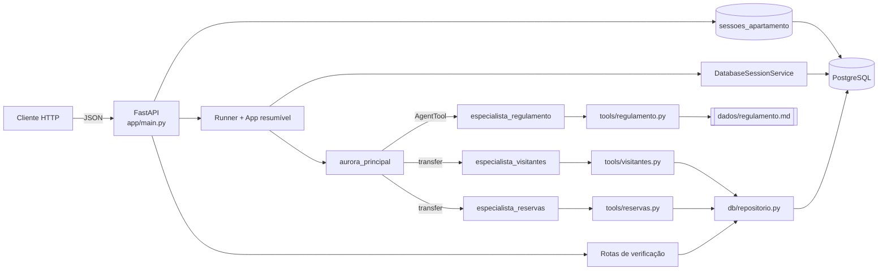
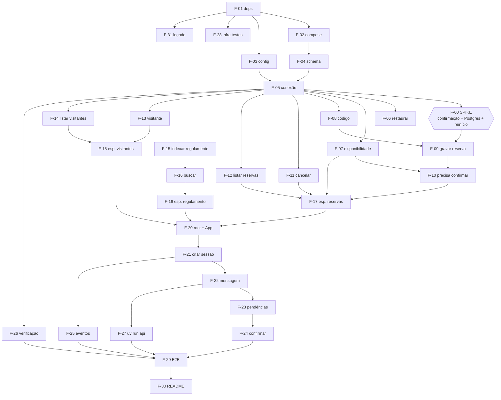
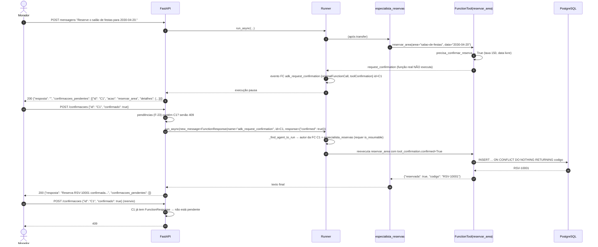
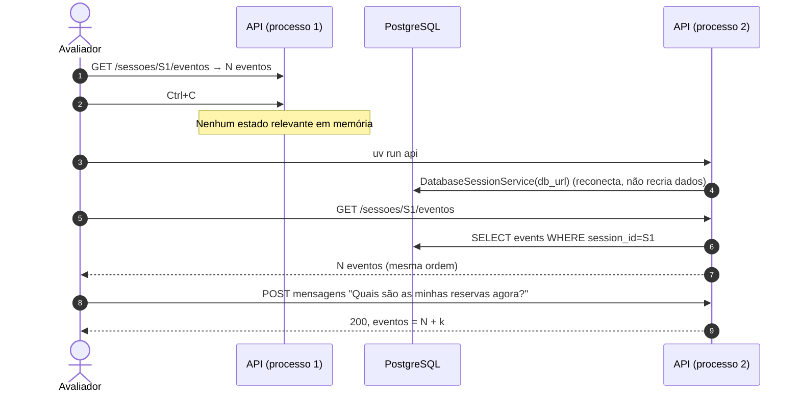

# FDD — Assistente Virtual do Residencial Aurora

Feature-Driven Development

| Campo | Valor |
|---|---|
| Documento base | [docs/PRD.md](PRD.md) |
| Metodologia | Feature-Driven Development (FDD), adaptado para um desenvolvedor com apoio de IA |
| Versão do ADK validada | `google-adk` 2.2.0 (código-fonte em `.venv/lib/python3.12/site-packages/google/adk`) |
| Status | Rascunho para implementação |
| Data | 2026-10-20 |
| Autor | Carlos Oliveira |

---

## 1. Objetivo do documento

Este FDD transforma o PRD em um plano de construção **orientado a features**. O documento traz:

1. o **modelo de domínio geral** (Processo 1 do FDD);
2. a **lista de features** agrupadas por área de negócio e por conjunto de features (Processo 2);
3. o **plano por feature**: ordem, dependências, esforço e responsável (Processo 3);
4. o **design por feature**: assinaturas, SQL, pseudocódigo e diagramas (Processo 4);
5. a **definição de pronto** de cada feature, com os critérios de aceite (CA-xx) e os testes (Processo 5).

Os IDs de regras (RN), requisitos funcionais (RF), garantias (G), requisitos não funcionais (RNF) e critérios de aceite (CA) são os do PRD.

---

## 2. Papéis e processo

### 2.1 Papéis (adaptação para dev solo + IA)

| Papel FDD clássico | Quem | Responsabilidade neste projeto |
|---|---|---|
| Project Manager / Chief Architect | Carlos | Decide a arquitetura, prioriza o plano e aprova desvios do PRD. |
| Chief Programmer | Carlos | Escolhe o próximo pacote de features, conduz o design por feature e faz as inspeções. |
| Class/Module Owner | Carlos (dono de todos os módulos) | Responde pelo código de cada módulo (seção 2.4). |
| Programador de apoio | Claude Code | Gera rascunhos de design e de código, escreve testes e roda `/code-review`. A aprovação final é sempre do Carlos. |
| Domain Expert | Regras do PRD (seções 5 e 7) | Fonte única das regras de negócio. |

### 2.2 Os cinco processos e os marcos por feature

| Processo FDD | Neste projeto |
|---|---|
| 1. Desenvolver o modelo geral | Seção 3 |
| 2. Construir a lista de features | Seção 5 |
| 3. Planejar por feature | Seção 6 |
| 4. Design por feature (DBF) | Seções 7 e 8 |
| 5. Build por feature (BBF) | Implementação + testes + inspeção, seguindo a definição de pronto (seção 9) |

O progresso de cada feature é medido pelos seis marcos clássicos do FDD:

| Marco | Peso | Critério de conclusão |
|---|---|---|
| Walkthrough do domínio | 1% | A feature foi relida contra o PRD, e as dúvidas foram resolvidas. |
| Design | 40% | Assinaturas, SQL e pseudocódigo da seção 8 confirmados ou ajustados. |
| Inspeção de design | 3% | Revisão do design contra G-1..G-5 (checklist da seção 9.2). |
| Código | 45% | Implementação e testes da feature escritos. |
| Inspeção de código | 10% | `uv run pytest`, `ruff` e `pyright` verdes + `/code-review` sem achados abertos. |
| Promoção ao build | 1% | Commit na `main`, com rastreabilidade atualizada na seção 10. |

### 2.3 Convenções de trabalho

As convenções de código, as regras invioláveis, as ferramentas de qualidade (`ruff`, `pyright`) e o padrão de Git estão no [CLAUDE.md](../CLAUDE.md) da raiz. Em resumo:

- identificadores em pt-BR;
- commits direto na `main`, no formato `tipo(escopo): F-xx descrição`;
- o modelo Gemini é escolhido no spike F-00.

### 2.4 Módulos e propriedade

| Módulo | Caminho | Conteúdo |
|---|---|---|
| Configuração | `app/config.py` | Leitura do `.env` |
| Banco | `app/db/` | `conexao.py`, `schema.sql`, `repositorio.py` |
| Tools | `app/tools/` | `reservas.py`, `visitantes.py`, `regulamento.py` |
| Agentes | `app/agents/` | `principal.py`, `reservas.py`, `visitantes.py`, `regulamento.py`, `app.py` (App + Runner) |
| API | `app/main.py`, `app/api/` | Rotas, `schemas.py`, `confirmacoes.py`, `sessoes.py` |
| Scripts | `scripts/` | `restaurar.py`, `api.py` |
| Testes | `tests/` | `unit/`, `api/`, `e2e/`, `conftest.py`, `stub_llm.py` |

---

## 3. Modelo de domínio geral (Processo 1)

### 3.1 Domínio do condomínio



Invariantes do domínio:

- **INV-1 (RN-1, G-5):** para cada par `(area, data)` existe no máximo uma `Reserva` com `status = 'ativa'`. O banco garante isso com um índice único parcial.
- **INV-2 (RN-5):** `Reserva.codigo` é único em toda a história, inclusive entre reservas canceladas e através de restaurações.
- **INV-3 (G-2):** toda operação de escrita ou leitura de dados pessoais recebe o apartamento **da sessão**, nunca um valor vindo do modelo.

### 3.2 Domínio da conversa



`ConfirmacaoPendente` **não é persistida** em tabela própria. Ela é **derivada** dos eventos da sessão a cada requisição (F-23). Assim, a fonte da verdade é sempre o histórico persistido pelo ADK (G-1, G-3).

### 3.3 Arquitetura de componentes



---

## 4. Validação técnica do ADK 2.2.0

Antes deste FDD, as APIs citadas no PRD foram conferidas no código-fonte instalado. Os resultados abaixo orientam o design.

| # | Item | Achado no código | Impacto no design |
|---|---|---|---|
| V-1 | `FunctionTool(func, require_confirmation=...)` | Aceita `bool` ou `Callable[..., bool]` (`tools/function_tool.py:53`). O callable é chamado com **os mesmos kwargs da tool**, incluindo `tool_context` se a função o declarar (`function_tool.py:245`). | `precisa_confirmar_reserva` tem a **mesma assinatura** de `reservar_area` (F-10). |
| V-2 | Pedido de confirmação | Sem `tool_context.tool_confirmation`, a tool chama `request_confirmation`, marca `skip_summarization=True` e devolve `{"error": "This tool call requires confirmation..."}`. **A função real não executa.** | Nada é gravado antes da aprovação (CA-07). |
| V-3 | Negação | Com `confirmed=False`, devolve `{"error": "This tool call is rejected."}` e **não executa** a função. | Negar não grava nada (CA-08). |
| V-4 | Evento de confirmação | Nome `adk_request_confirmation` (`flows/llm_flows/functions.py:59`). Args: `originalFunctionCall` (`id`, `name`, `args`) e `toolConfirmation` (`hint`, `confirmed`, `payload`). O `id` é gerado pelo cliente ADK e marcado como long-running. | F-23 extrai `id`, `acao` e `detalhes` desses campos. |
| V-5 | Resposta do cliente | `FunctionResponse(name="adk_request_confirmation", id=<id>, response={"confirmed": bool})`. Também é aceito `{"response": "<json>"}` (`request_confirmation.py: _parse_tool_confirmation`). | F-24 envia o formato direto `{"confirmed": bool}`. |
| V-6 | Roteamento da retomada | `Runner._find_agent_to_run` (`runners.py:1688`) só envia a function response ao agente autor da function call **se `resumability_config.is_resumable` for `True`**. Sem isso, a execução volta ao root e a ação **não executa** (o "erro silencioso"). | `App(..., resumability_config=ResumabilityConfig(is_resumable=True))` é obrigatório (F-20). |
| V-7 | Execução pelo menos uma vez | A docstring de `ResumabilityConfig` avisa que a retomada garante execução *at-least-once*, então a tool retomada deve ser idempotente. | As gravações precisam ser idempotentes: reserva via índice único (INV-1); visitante via `UNIQUE (apartamento, nome, data)` (ajuste A-2). |
| V-8 | `Runner.run_async` | Aceita `invocation_id` opcional para retomar uma invocação interrompida (`runners.py:949`). | O spike F-00 decide se a rota de confirmação passa o `invocation_id` do evento de confirmação ou só a `new_message`. |
| V-9 | `AgentTool` | Executa o agente filho num `Runner` próprio com **`InMemorySessionService`** (`tools/agent_tool.py:247`). O state do pai é copiado para a sessão filha. Só o texto final volta como `FunctionResponse` ao pai. | Isolamento do regulamento confirmado (G-4). A saída de `buscar_regulamento` não entra nos eventos da sessão principal. |
| V-10 | `DatabaseSessionService(db_url, **kwargs)` | Cria as tabelas sozinho. Schema v1: `sessions`, `events`, `app_states`, `user_states` e `adk_internal_metadata`. | Os nomes das nossas tabelas não podem colidir com esses. A restauração apaga `events`, `sessions`, `app_states` e `user_states`, mas **não** `adk_internal_metadata`. |
| V-11 | `session_service.get_session` | Exige `app_name`, `user_id` e `session_id`. | A API precisa descobrir o `user_id` a partir do `session_id`. Daí a tabela `sessoes_apartamento` (ajuste A-1). |

### 4.1 Ajustes em relação ao PRD

| ID | Ajuste | Motivo |
|---|---|---|
| A-1 | Nova tabela `sessoes_apartamento(session_id PK, apartamento, criado_em)`. | V-11: localizar a sessão (e responder `404`) só com o `session_id`. Ela também guarda o apartamento autenticado, que fica imutável fora do controle do modelo (G-2). |
| A-2 | `visitantes` usa **chave primária composta** `PRIMARY KEY (apartamento, nome, data)`, sem id artificial. A inserção usa `ON CONFLICT DO NOTHING`. | V-7: idempotência da retomada. O apartamento (número único, PK de `apartamentos`) faz parte da PK do visitante. |
| A-3 | O código da reserva é gerado **dentro** do `INSERT` (`'RSV-' \|\| nextval(...)`). | Uma única instrução atômica (G-5, RN-5). |
| A-4 | A restauração também apaga `sessoes_apartamento`. | Consistência com a remoção das sessões (RF-13). |

---

## 5. Lista de features (Processo 2)

Formato FDD: **\<ação\> \<resultado\> \<por/para/de\> \<objeto\>**. Esforço em pontos relativos (1 = trivial, 2 = pequeno, 3 = médio, 5 = grande, 8 = incerto).

### Área 0 — Redução de risco

| ID | Feature | Pts |
|---|---|---|
| F-00 | **Validar** a retomada da confirmação **com** sessão PostgreSQL e reinício (spike) | 5 |

### Área A — Fundação

**FS-A1 Ambiente**

| ID | Feature | Pts |
|---|---|---|
| F-01 | **Fixar** as dependências e os scripts **do** projeto | 1 |
| F-02 | **Provisionar** o PostgreSQL **por** docker compose | 1 |
| F-03 | **Carregar** as configurações **a partir do** `.env` | 1 |

**FS-A2 Persistência**

| ID | Feature | Pts |
|---|---|---|
| F-04 | **Criar** o schema **do** condomínio | 2 |
| F-05 | **Abrir** conexões assíncronas **para** o banco | 1 |
| F-06 | **Restaurar** o estado inicial **a partir de** `dados/` | 3 |

### Área B — Reservas

**FS-B1 Consulta**

| ID | Feature | Pts |
|---|---|---|
| F-07 | **Verificar** a disponibilidade **de** uma área numa data | 1 |
| F-12 | **Listar** as reservas **do** apartamento da sessão | 1 |

**FS-B2 Gravação**

| ID | Feature | Pts |
|---|---|---|
| F-08 | **Gerar** o código único **de** uma reserva | 1 |
| F-09 | **Gravar** atomicamente a reserva **de** uma área | 3 |
| F-10 | **Calcular** a necessidade de confirmação **de** uma reserva | 2 |
| F-11 | **Cancelar** a reserva **do** apartamento da sessão | 2 |

### Área C — Visitantes

| ID | Feature | Pts |
|---|---|---|
| F-13 | **Autorizar** a entrada **de** um visitante | 2 |
| F-14 | **Listar** os visitantes **do** apartamento da sessão | 1 |

### Área D — Regulamento

| ID | Feature | Pts |
|---|---|---|
| F-15 | **Indexar** o regulamento **por** capítulo e artigo | 2 |
| F-16 | **Buscar** o trecho relevante **do** regulamento | 3 |

### Área E — Agentes

| ID | Feature | Pts |
|---|---|---|
| F-17 | **Montar** o especialista **de** reservas | 2 |
| F-18 | **Montar** o especialista **de** visitantes | 1 |
| F-19 | **Montar** o especialista **de** regulamento como `AgentTool` | 2 |
| F-20 | **Montar** o agente principal e o `App` resumível **do** assistente | 3 |

### Área F — API e sessões

| ID | Feature | Pts |
|---|---|---|
| F-21 | **Criar** a sessão **de** um apartamento | 2 |
| F-22 | **Processar** a mensagem **de** um morador | 3 |
| F-23 | **Extrair** as confirmações pendentes **de** uma sessão | 3 |
| F-24 | **Responder** a confirmação pendente **de** uma sessão | 5 |
| F-25 | **Listar** os eventos **de** uma sessão | 1 |
| F-26 | **Expor** as reservas e os visitantes **de** um apartamento (verificação) | 1 |
| F-27 | **Subir** a API **em** `localhost:8000` | 1 |

### Área G — Qualidade e entrega

| ID | Feature | Pts |
|---|---|---|
| F-28 | **Preparar** a infraestrutura de testes **com** banco `aurora_test` e LLM stub | 3 |
| F-29 | **Automatizar** o fluxo de validação **em** testes E2E | 3 |
| F-30 | **Documentar** a arquitetura, as garantias e a execução **no** README | 2 |
| F-31 | **Ajustar** os artefatos legados **do** repositório | 1 |

**Total estimado: 65 pontos.**

---

## 6. Plano por feature (Processo 3)

### 6.1 Grafo de dependências



### 6.2 Pacotes de trabalho (iterações)

| Iteração | Features | Pts | Objetivo / marco de saída |
|---|---|---|---|
| **I-0 Fundação** | F-01, F-02, F-03, F-04, F-05, F-31 | 7 | `docker compose up -d` + schema criado + `uv sync` limpo. |
| **I-1 Spike** | F-00 | 5 | Confirmar → reiniciar → aprovar funcionando com Postgres. **Gate:** sem isso, não avançar para I-4. |
| **I-2 Domínio de dados** | F-06, F-07, F-08, F-09, F-10, F-11, F-12, F-13, F-14, F-28 | 19 | Repositório + tools testados sem LLM (G-2, G-5, RN-1..5). |
| **I-3 Regulamento** | F-15, F-16 | 5 | Busca devolve só o capítulo relevante (G-4). |
| **I-4 Agentes** | F-17, F-18, F-19, F-20 | 8 | Topologia funcional no `adk web` e no Runner com Postgres. |
| **I-5 API** | F-21, F-22, F-23, F-24, F-25, F-26, F-27 | 16 | Contrato completo, com testes de API pelo LLM stub. |
| **I-6 Validação e entrega** | F-29, F-30 | 5 | Fluxo E2E (passos 1–15) verde com Gemini e README final. |

---

## 7. Fluxos principais (diagramas de sequência)

### 7.1 Mensagem sem confirmação (ex.: reservar a quadra)

```mermaid
sequenceDiagram
    autonumber
    actor M as Morador
    participant API as FastAPI
    participant SA as sessoes_apartamento
    participant R as Runner (App resumível)
    participant ROOT as aurora_principal
    participant ER as especialista_reservas
    participant T as reservar_area
    participant DB as PostgreSQL

    M->>API: POST /sessoes/{id}/mensagens {"texto": "Reserve a quadra para 2030-04-06."}
    API->>SA: SELECT apartamento WHERE session_id=id
    alt não encontrada
        API-->>M: 404
    end
    API->>R: run_async(user_id=apto, session_id=id, new_message)
    R->>ROOT: LLM decide
    ROOT->>ER: transfer_to_agent
    ER->>T: reservar_area(area="quadra", data="2030-04-06")
    T->>T: precisa_confirmar_reserva → False (taxa 0)
    T->>DB: INSERT ... ON CONFLICT DO NOTHING RETURNING codigo
    DB-->>T: RSV-10000
    T-->>ER: {"reservada": true, "codigo": "RSV-10000", ...}
    ER-->>R: texto final
    R-->>API: eventos (persistidos em events)
    API->>API: resposta = textos finais; pendências = F-23
    API-->>M: 200 {"resposta": "...", "confirmacoes_pendentes": []}
```

### 7.2 Confirmação: pedido e aprovação (ex.: salão de festas)



### 7.3 Disputa concorrente (passo 14)

```mermaid
sequenceDiagram
    autonumber
    participant S3 as Aprovação S3 (apto 101)
    participant S4 as Aprovação S4 (apto 201)
    participant DB as PostgreSQL<br/>ux_reserva_ativa_area_data

    par simultâneo
        S3->>DB: INSERT (101, salao, 2030-05-11) ON CONFLICT DO NOTHING RETURNING codigo
    and
        S4->>DB: INSERT (201, salao, 2030-05-11) ON CONFLICT DO NOTHING RETURNING codigo
    end
    Note over DB: O índice único parcial serializa a<br/>inserção; uma espera o commit da outra
    DB-->>S3: RSV-10007 (venceu)
    DB-->>S4: nenhuma linha (conflito)
    S3-->>S3: {"reservada": true} → HTTP 200
    S4-->>S4: {"reservada": false, "motivo": "data ocupada"} → HTTP 200
```

### 7.4 Reinício (passo 13)



---

## 8. Design por feature (Processo 4)

Convenções:

- Pacote raiz `app`. Todo acesso ao banco é **async** (SQLAlchemy 2 + asyncpg).
- Toda tool recebe `tool_context: ToolContext` e lê o apartamento via `apartamento_da_sessao(tool_context)`.
- Datas chegam como `str` ISO (`AAAA-MM-DD`) e são validadas com `date.fromisoformat`. Uma data inválida devolve `{"erro": "data inválida, use AAAA-MM-DD"}` (sem exceção).
- Retornos de tool são `dict` simples. **Nenhum** retorno contém apartamento de terceiros nem código de reserva de terceiros (G-2).

---

### F-00 — Validar a retomada da confirmação com sessão PostgreSQL e reinício (spike)

**Objetivo:** eliminar cedo o risco nº 4 do PRD.

**Roteiro do spike** (código descartável em `spikes/confirmacao/`, fora do pacote `app`):

1. Montar `root` (sem tools) → `sub_agents=[esp]`, em que `esp` tem `FunctionTool(acao_cobrada, require_confirmation=True)` gravando numa tabela de teste.
2. `App(name="spike", root_agent=root, resumability_config=ResumabilityConfig(is_resumable=True))`.
3. `Runner(app=app, session_service=DatabaseSessionService(DATABASE_URL))`.
4. Enviar a mensagem → capturar o `id` de `adk_request_confirmation` nos eventos.
5. **Encerrar o processo.** Num novo processo, recriar o Runner e enviar a `FunctionResponse` em duas variantes:
   - (a) só a `new_message`;
   - (b) a `new_message` + `invocation_id` do evento de confirmação.
6. Verificar que a tabela recebeu exatamente 1 linha, que um segundo envio do mesmo `id` não grava de novo e que `confirmed=False` não grava.

7. **Medir a cota e escolher o modelo:** rodar o roteiro com um Gemini candidato, anotar quantas chamadas ao modelo cada turno consome (log do Runner) e comparar com os limites por minuto e por dia exibidos no Google AI Studio. Projetar o consumo do fluxo completo: cerca de 14 passos × chamadas por turno, mais uma margem de 2× para repetições do E2E.

**Matriz de execução:**

| Cenário | Variante (a) só `new_message` | Variante (b) + `invocation_id` |
|---|---|---|
| Mesmo processo, aprovar | ☑ 1 execução | não testada |
| Mesmo processo, negar | ☑ 0 execuções | não testada |
| Após reinício, aprovar | ☑ 1 execução | não testada |
| Após reinício, negar | ☑ 0 execuções | não testada |
| Reenvio do mesmo `id` (deve ser bloqueado pela API) | ☑ `id` sai das pendências após a resposta | não testada |

#### Resultado do spike (2026-10-20)

- **Decisão:** variante **(a)**: só a `new_message` com a `FunctionResponse`, e `USAR_INVOCATION_ID = False`. A (b) não precisou ser testada (regra 1 da árvore).
- **Ambiente:** `google-adk==2.2.0` (mantida), `DatabaseSessionService` em PostgreSQL 16 e topologia root → sub-agente com `transfer_to_agent`, `disallow_transfer_to_peers=True` e `ResumabilityConfig(is_resumable=True)`.
- **Sequência observada:** `principal` chama `transfer_to_agent`. Em seguida, `especialista_cobrancas` chama `acao_cobrada`, e a tool devolve `{"error": "...requires confirmation..."}` acompanhada de `adk_request_confirmation` (a execução pausa com `resposta = ""`). Na resposta, o Runner volta ao `especialista_cobrancas`, que executa a tool e gera o texto final.
- **Modelo:** `gemini-3.6-flash` para o principal e os especialistas. Consumo medido: **2 chamadas ao LLM no turno que pede a confirmação** (root + especialista) e **1 chamada na resposta**. Projeção para o fluxo completo: cerca de 20 turnos × 2–3 chamadas, mais o especialista de regulamento, dá **~60 chamadas** (~120 com a margem do E2E). Os limites do projeto precisam ser conferidos no AI Studio.
- **Achado:** a primeira execução falhou com **`503 UNAVAILABLE`** ("model is experiencing high demand"), por sobrecarga do Gemini, não por erro do código. **Mitigação adotada:** todo agente usa `Gemini(model=..., retry_options=HttpRetryOptions(attempts=6, initial_delay=2, max_delay=30, exp_base=2, jitter=1, http_status_codes=[429, 500, 503, 504]))`, num helper `criar_modelo()` (F-20). Com isso, as execuções seguintes passaram.
- Código do spike: `spikes/confirmacao/spike.py`.

**Árvore de decisão (critério de saída):**

1. Se (a) passar em todos os cenários → adotar (a), que é a mais simples, e `USAR_INVOCATION_ID = False`.
2. Senão, se (b) passar em todos → adotar (b).
3. Senão, repetir (a) e (b) com `disallow_transfer_to_parent=True` nos especialistas transacionais.
4. Senão, mudar a topologia: as tools confirmáveis (`reservar_area`, `autorizar_visitante`) passam para o **próprio root**. Os especialistas de reservas e de visitantes continuam como sub-agentes para consulta, listagem e cancelamento. Assim o requisito de "≥ 2 especialistas" continua atendido.
5. Senão, testar a versão 2.x mais recente estável (fixada com `==`) e voltar ao passo 1.
6. Se mesmo assim falhar, **parar e reavaliar** antes de seguir para I-2. Esse risco invalida G-1.

**Timebox:** 1 dia de trabalho. Estourou o timebox → aplicar a próxima etapa da árvore em vez de depurar a etapa atual.

**Saída:** decisão registrada (1) nesta seção, (2) no README (seção Garantias, G-1) e (3) no `pyproject.toml` (versão do ADK) e no `.env.example` (modelos escolhidos: `MODELO_PRINCIPAL` e `MODELO_ESPECIALISTAS`).

**Pronto quando:** a matriz tem uma coluna inteira verde (gravou exatamente uma vez com aprovação e zero vezes com negação, com e sem reinício), e o modelo foi escolhido com o consumo projetado dentro da cota.

---

### F-01 — Fixar as dependências e os scripts do projeto

`pyproject.toml`:

```toml
[project]
name = "residencial-aurora"
requires-python = ">=3.12"
dependencies = [
    "google-adk==2.2.0",          # versão exata (ajustar após F-00)
    "fastapi",
    "uvicorn[standard]",
    "sqlalchemy[asyncio]>=2",
    "asyncpg",
    "python-dotenv",
]

[project.scripts]
api = "scripts.api:main"
restaurar = "scripts.restaurar:main"

[dependency-groups]
dev = ["pytest", "pytest-asyncio", "httpx", "ruff", "pyright"]

[tool.pytest.ini_options]
asyncio_mode = "auto"
markers = ["e2e: fluxo completo com Gemini real"]
addopts = "-m 'not e2e'"

[tool.ruff]
line-length = 100
target-version = "py312"

[tool.ruff.lint]
select = ["E", "F", "W", "I", "B", "UP", "ASYNC", "S"]   # S = bandit (SQL/segredos)
ignore = ["S101"]                                           # assert nos testes

[tool.pyright]
pythonVersion = "3.12"
typeCheckingMode = "basic"
include = ["app", "scripts", "tests"]
```

Para os `project.scripts` funcionarem, o projeto precisa ser instalável. Isso exige `[build-system]` com hatchling e `packages = ["app", "scripts"]`.

Ajustes feitos na implementação (I-0):
- O extra `google-adk[extensions]` foi removido. O `DatabaseSessionService` só precisa de `sqlalchemy` + `asyncpg`, que já são dependências diretas.
- `[tool.ruff] extend-exclude = ["docs"]`, porque o `ruff format` tentava formatar o pseudocódigo dos blocos Python do PRD/FDD.
- `Config.validar_gemini()` separa a validação das variáveis do Gemini, para que `uv run restaurar` rode sem `GOOGLE_API_KEY`.

**Pronto quando:** `uv sync` é limpo, `uv run api --help` e `uv run restaurar --help` resolvem, `uv run ruff check .` e `uv run pyright` passam, e `uv.lock` está atualizado. *(CA-01)*

---

### F-02 — Provisionar o PostgreSQL por docker compose

`docker-compose.yml`:

```yaml
services:
  postgres:
    image: postgres:16
    environment:
      POSTGRES_USER: ${POSTGRES_USER}
      POSTGRES_PASSWORD: ${POSTGRES_PASSWORD}
      POSTGRES_DB: ${POSTGRES_DB}
    ports: ["${POSTGRES_PORT:-5432}:5432"]
    volumes: ["pgdata:/var/lib/postgresql/data"]
    healthcheck:
      test: ["CMD-SHELL", "pg_isready -U ${POSTGRES_USER}"]
      interval: 2s
      retries: 30
volumes:
  pgdata:
```

**Pronto quando:** `docker compose up -d` deixa o serviço `healthy`, e os dados sobrevivem a `docker compose restart`.

---

### F-03 — Carregar as configurações a partir do `.env`

```python
# app/config.py
@dataclass(frozen=True)
class Config:
    google_api_key: str
    modelo_principal: str
    modelo_especialistas: str
    database_url: str          # postgresql+asyncpg://...
    app_name: str = "residencial_aurora"
    dir_dados: Path = Path("dados")

def carregar_config() -> Config: ...   # load_dotenv(); falha clara se faltar variável
```

`.env.example` com as variáveis da seção 11.1 do PRD.

**Pronto quando:** a ausência de `GOOGLE_API_KEY` ou de `DATABASE_URL` gera uma mensagem de erro legível na subida. *(CA-04)*

---

### F-04 — Criar o schema do condomínio

`app/db/schema.sql` (idempotente):

```sql
CREATE TABLE IF NOT EXISTS apartamentos (numero TEXT PRIMARY KEY, morador TEXT NOT NULL);
CREATE TABLE IF NOT EXISTS areas (id TEXT PRIMARY KEY, nome TEXT NOT NULL, taxa NUMERIC(10,2) NOT NULL);

CREATE SEQUENCE IF NOT EXISTS seq_codigo_reserva START 10000;

CREATE TABLE IF NOT EXISTS reservas (
    codigo       TEXT PRIMARY KEY,
    apartamento  TEXT NOT NULL REFERENCES apartamentos(numero),
    area         TEXT NOT NULL REFERENCES areas(id),
    data         DATE NOT NULL,
    status       TEXT NOT NULL DEFAULT 'ativa' CHECK (status IN ('ativa','cancelada')),
    criado_em    TIMESTAMPTZ NOT NULL DEFAULT now(),
    cancelado_em TIMESTAMPTZ
);
CREATE UNIQUE INDEX IF NOT EXISTS ux_reserva_ativa_area_data
    ON reservas (area, data) WHERE status = 'ativa';

CREATE TABLE IF NOT EXISTS visitantes (
    apartamento TEXT NOT NULL REFERENCES apartamentos(numero),
    nome        TEXT NOT NULL,
    data        DATE NOT NULL,
    criado_em   TIMESTAMPTZ NOT NULL DEFAULT now(),
    PRIMARY KEY (apartamento, nome, data)                           -- A-2
);

CREATE TABLE IF NOT EXISTS sessoes_apartamento (                    -- A-1
    session_id  TEXT PRIMARY KEY,
    apartamento TEXT NOT NULL REFERENCES apartamentos(numero),
    criado_em   TIMESTAMPTZ NOT NULL DEFAULT now()
);
```

Nenhuma tabela pode se chamar `sessions`, `events`, `app_states`, `user_states` ou `adk_internal_metadata`, porque esses nomes são do ADK (V-10).

**Pronto quando:** aplicar o schema duas vezes não gera erro. *(G-5 · CA-26)*

---

### F-05 — Abrir conexões assíncronas para o banco

```python
# app/db/conexao.py
def criar_engine(database_url: str) -> AsyncEngine: ...
async def aplicar_schema(engine: AsyncEngine) -> None: ...     # executa schema.sql
@asynccontextmanager
async def transacao(engine) -> AsyncIterator[AsyncConnection]: # engine.begin()
```

O engine é um singleton por processo (criado no `lifespan` da FastAPI) e é compartilhado pelas tools via `app/db/__init__.py: obter_engine()`.

**Pronto quando:** `aplicar_schema` roda no `lifespan` da API e no `restaurar`.

---

### F-06 — Restaurar o estado inicial a partir de `dados/`

```python
# scripts/restaurar.py
def main() -> None: asyncio.run(restaurar())

async def restaurar(engine=None) -> None:
    await aplicar_schema(engine)
    # Garante as tabelas do ADK (instancia DatabaseSessionService uma vez)
    async with transacao(engine) as c:
        upsert apartamentos  ← dados/apartamentos.json
        upsert areas         ← dados/areas.json
        DELETE FROM reservas; DELETE FROM visitantes;
        INSERT reservas (status='ativa')  ← dados/reservas.json
        INSERT visitantes                 ← dados/visitantes.json
        DELETE FROM events; DELETE FROM sessions;
        DELETE FROM app_states; DELETE FROM user_states;
        DELETE FROM sessoes_apartamento;
        -- NÃO mexe em seq_codigo_reserva (RN-5)
```

Os arquivos de `dados/` só são **lidos**, nunca escritos.

**Pronto quando:** depois de `uv run restaurar`, `GET /apartamentos/101/reservas` = `[RSV-1377]`, `GET /apartamentos/302/visitantes` = `[Marina Duarte]` e não existe nenhuma sessão. Rodar duas vezes seguidas dá o mesmo resultado. *(RF-13 · CA-02, CA-03 · passo 1)*

**Testes:** `tests/unit/test_restaurar.py`.

---

### F-07 — Verificar a disponibilidade de uma área numa data

```python
# app/db/repositorio.py
async def obter_area(conn, area_id: str) -> Area | None
async def data_ocupada(conn, area_id: str, data: date) -> bool
    # SELECT EXISTS(SELECT 1 FROM reservas WHERE area=:a AND data=:d AND status='ativa')

# app/tools/reservas.py
async def verificar_disponibilidade(area: str, data: str, tool_context: ToolContext) -> dict:
    """Informa se uma área comum está livre numa data (AAAA-MM-DD).
    area: salao-de-festas | churrasqueira | quadra."""
    → {"area": area, "data": data, "disponivel": bool, "taxa": float}
```

Não retorna dono, código nem apartamento. *(RF-03 · G-2)*

**Testes:** salão em 2030-03-16 → `disponivel: false`, e o retorno serializado não contém `RSV-4821` nem `302`.

---

### F-08 — Gerar o código único de uma reserva

O código é gerado dentro do `INSERT` (A-3): `'RSV-' || nextval('seq_codigo_reserva')`. A sequence começa em 10000, então nunca colide com `RSV-1377`, `RSV-4821` ou `RSV-2950`. Ela não é reiniciada (F-06), e o cancelamento não apaga linhas. *(RN-5 · CA-20)*

**Testes:** 50 reservas em datas distintas → 50 códigos distintos, nenhum entre os códigos iniciais. Restaurar → nova reserva → código maior que todos os anteriores.

---

### F-09 — Gravar atomicamente a reserva de uma área

```python
# app/db/repositorio.py
async def inserir_reserva(conn, apartamento: str, area_id: str, data: date) -> str | None:
    """Retorna o código criado ou None se (area, data) já tem reserva ativa."""
```

```sql
INSERT INTO reservas (codigo, apartamento, area, data, status)
VALUES ('RSV-' || nextval('seq_codigo_reserva'), :apto, :area, :data, 'ativa')
ON CONFLICT DO NOTHING
RETURNING codigo;
```

```python
# app/tools/reservas.py
async def reservar_area(area: str, data: str, tool_context: ToolContext) -> dict:
    """Reserva uma área comum para o apartamento do morador numa data (AAAA-MM-DD).
    Áreas com taxa exigem aprovação do morador pelo sistema antes de gravar."""
    apto = apartamento_da_sessao(tool_context)
    valida area/data → erro amigável
    codigo = await inserir_reserva(conn, apto, area, d)
    if codigo is None:
        return {"reservada": False, "motivo": "data ocupada"}
    return {"reservada": True, "codigo": codigo, "area": area, "data": data,
            "cobranca": taxa > 0, "taxa": taxa}
```

Defesa adicional: capturar `IntegrityError` (unique violation) → mesmo retorno de "data ocupada". Nunca gera `5xx`. *(RN-1, G-5 · CA-24, CA-25, CA-26)*

**Testes:** `asyncio.gather` de 10 `inserir_reserva` concorrentes (apartamentos distintos, mesma área e data) → exatamente 1 código e 9 `None`, sem exceção. `SELECT count(*) ... status='ativa'` = 1.

---

### F-10 — Calcular a necessidade de confirmação de uma reserva

```python
# app/tools/reservas.py
async def precisa_confirmar_reserva(area: str, data: str, tool_context: ToolContext) -> bool:
    """require_confirmation dinâmico (mesma assinatura de reservar_area — V-1)."""
    area_obj = await obter_area(conn, area)
    if area_obj is None or data inválida:
        return False                     # a tool devolverá erro sem gravar nada
    if area_obj.taxa <= 0:
        return False                     # RN-2: sem cobrança
    if await data_ocupada(conn, area, d):
        return False                     # nada será cobrado; a tool devolverá "ocupada"
    return True

reservar_area_tool = FunctionTool(reservar_area, require_confirmation=precisa_confirmar_reserva)
```

Mesmo que a data fique ocupada **entre** a confirmação e a gravação, o `INSERT` atômico de F-09 garante INV-1. *(RN-2, G-1 · CA-07, CA-12, CA-17)*

**Testes:** salão livre → `True`; churrasqueira livre → `True`; quadra → `False`; salão em 2030-03-16 → `False`; área inexistente → `False`.

---

### F-11 — Cancelar a reserva do apartamento da sessão

```python
# app/db/repositorio.py
async def cancelar_reserva(conn, apartamento: str, area_id: str, data: date) -> str | None:
```

```sql
UPDATE reservas SET status='cancelada', cancelado_em=now()
WHERE apartamento=:apto AND area=:area AND data=:data AND status='ativa'
RETURNING codigo;
```

```python
# app/tools/reservas.py
async def cancelar_reserva(area: str, data: str, tool_context: ToolContext) -> dict:
    """Cancela uma reserva do próprio apartamento do morador (área + data)."""
    → {"cancelada": True, "codigo": "<código próprio>", "area": ..., "data": ...}
    → {"cancelada": False, "motivo": "nenhuma reserva sua encontrada para essa área e data"}
```

Registrada **sem** `require_confirmation` (RN-4). *(RF-06, G-2 · CA-15, CA-16 · passos 4, 5)*

**Testes:** sessão 101 cancela a quadra em 2030-03-09 → `RSV-1377` cancelada. Sessão 101 tenta cancelar o salão em 2030-03-16 → nada muda, e o retorno não contém `RSV-4821` nem `302`.

---

### F-12 — Listar as reservas do apartamento da sessão

```python
async def listar_reservas(conn, apartamento: str) -> list[dict]   # ativas, ORDER BY data
async def listar_minhas_reservas(tool_context: ToolContext) -> dict:
    → {"reservas": [{"codigo", "area", "data"}]}
```

*(RF-07, G-2 · passo 13)*

---

### F-13 — Autorizar a entrada de um visitante

```python
# app/db/repositorio.py
async def inserir_visitante(conn, apartamento: str, nome: str, data: date) -> bool:
    # INSERT ... ON CONFLICT (apartamento, nome, data) DO NOTHING
    # True se inseriu ou se já existia (idempotente — V-7)

# app/tools/visitantes.py
async def autorizar_visitante(nome: str, data: str, tool_context: ToolContext) -> dict:
    """Autoriza a entrada de um visitante (nome completo) no prédio numa data (AAAA-MM-DD).
    Exige aprovação do morador pelo sistema antes de gravar."""
    → {"autorizado": True, "nome": nome, "data": data}

autorizar_visitante_tool = FunctionTool(
    autorizar_visitante, require_confirmation=precisa_confirmar_visitante)
```

**Ajuste na implementação (I-2):** em vez de `require_confirmation=True`, a tool usa `precisa_confirmar_visitante(nome, data, tool_context)`. A função pede confirmação para **toda** autorização válida e não pede quando o nome está vazio ou a data é inválida. Nesses casos a tool devolve `{"erro": ...}` sem liberar acesso, e o morador não recebe uma pendência de algo que não seria executado. G-1 continua valendo: nenhum caminho grava visitante sem aprovação.

A frase "já estou confirmando aqui" não tem efeito: a confirmação só existe via `FunctionResponse` enviada pela rota (F-24). *(RN-3, G-1 · CA-13 · passo 11)*

---

### F-14 — Listar os visitantes do apartamento da sessão

```python
async def listar_visitantes(conn, apartamento: str) -> list[dict]   # ORDER BY data, nome
async def listar_meus_visitantes(tool_context: ToolContext) -> dict:
    → {"visitantes": [{"nome", "data"}]}
```

*(RF-07, G-2 · passo 3)*

---

### Helper comum (G-2)

```python
# app/tools/_sessao.py
def apartamento_da_sessao(tool_context: ToolContext) -> str:
    apto = tool_context.state.get("apartamento")
    if not apto:
        raise RuntimeError("sessão sem apartamento")   # nunca deveria ocorrer
    return apto
```

Nenhuma tool declara um parâmetro `apartamento`. O teste `tests/unit/test_assinaturas.py` inspeciona `inspect.signature` de todas as tools registradas e falha se encontrar esse parâmetro. *(CA-18)*

---

### F-15 — Indexar o regulamento por capítulo e artigo

```python
# app/tools/regulamento.py
@dataclass(frozen=True)
class Capitulo:
    numero: str           # "IV"
    titulo: str           # "Piscina"
    texto: str            # texto integral do capítulo
    artigos: list[str]    # "**Art. 22.** ..." + incisos/parágrafos

@lru_cache
def carregar_regulamento(caminho: Path = Path("dados/regulamento.md")) -> list[Capitulo]:
    # split por linhas que começam com "## Capítulo"
    # dentro do capítulo, split por "**Art. N.**"
```

**Pronto quando:** o regulamento é carregado com 14 capítulos, e o Capítulo IV tem título "Piscina".

---

### F-16 — Buscar o trecho relevante do regulamento

```python
def buscar_regulamento(consulta: str) -> dict:
    """Busca no regulamento interno o trecho que responde à dúvida do morador.
    Retorna somente o capítulo mais relevante (e seus artigos relevantes)."""
    → {"capitulo": "IV", "titulo": "Piscina", "trechos": ["**Art. 22.** ..."]}
```

Algoritmo (determinístico, sem LLM):

1. Normalizar a consulta (minúsculas, sem acentos, sem stopwords).
2. Pontuar cada capítulo: **título** (peso 5) + mapa de sinônimos assunto→capítulo (peso 3, ex.: `piscina|nadar|deck → IV`, `cachorro|gato|pet → VIII`, `barulho|silencio → III`, `visitante|portaria → VII`, `salao|churrasqueira|quadra|reserva → VI`) + frequência dos termos no texto (peso 1).
3. Escolher **um único** capítulo, o de maior pontuação.
4. Dentro dele, devolver os artigos com pelo menos um termo da consulta (no máximo 3). Se nenhum casar, devolver os 2 primeiros artigos do capítulo.
5. Nunca concatenar texto de dois capítulos.

*(RF-09, G-4 · CA-21, CA-22)*

**Testes:** "Até que horas a piscina funciona aos domingos?" → Cap. IV com "20h" no trecho e sem "Capítulo" de outro número. "Posso ter cachorro?" → Cap. VIII.

**Implementado na I-3** (`app/tools/regulamento.py`):
- O índice tem 14 capítulos e 96 artigos (`**Art. N`). Cada artigo inclui seus incisos e parágrafos.
- **Radical simples:** a normalização tira o plural em `-s` de palavras com mais de 4 letras. Termos com 5 letras ou mais também casam como **prefixo** (ex.: `funciona` casa com `funcionamento`).
- **Pontuação:**
  - +5 se o termo aparece no título;
  - +3 se é sinônimo do capítulo;
  - +1 se aparece no texto, contando cada termo distinto uma vez só, para que capítulos longos não sejam favorecidos.
- **Assunto fora do regulamento:** se a melhor pontuação ficar abaixo de 2, a busca devolve `{"encontrado": false}`.
- **Artigos devolvidos:** os de pontuação igual à melhor ou à melhor − 1, no máximo 3, em ordem numérica.
- **Marcadores de vazamento** encontrados no regulamento: "coleira refletiva **cor de mostarda**" (Cap. VIII, Art. 54), "plástico bolha **lilás**" (Cap. IX, Art. 65) e "lona **xadrez vermelha**" (Cap. X, Art. 72). O teste da piscina verifica que nenhum deles aparece. O teste E2E do passo 12 deve verificar o mesmo nos eventos da sessão.
- **Resultado medido:** a consulta da piscina devolve os Arts. 22 e 27, com 847 caracteres (~2% dos 44.488 do regulamento).

---

### F-17 — Montar o especialista de reservas

```python
# app/agents/reservas.py
def criar_especialista_reservas(modelo: str) -> LlmAgent:
    return LlmAgent(
        name="especialista_reservas",
        model=modelo,
        description="Consulta disponibilidade, reserva, cancela e lista reservas de áreas comuns do apartamento do morador.",
        instruction=INSTRUCAO_RESERVAS,
        tools=[verificar_disponibilidade, reservar_area_tool, cancelar_reserva, listar_minhas_reservas],
        disallow_transfer_to_peers=True,
    )
```

Pontos obrigatórios de `INSTRUCAO_RESERVAS` (pseudo-prompt):

- Áreas válidas: `salao-de-festas`, `churrasqueira`, `quadra`. Converter o nome falado no `id`. Datas em `AAAA-MM-DD`.
- Sempre usar as tools. Nunca afirmar uma reserva sem o retorno da tool.
- O morador é **sempre** o apartamento da sessão. Ignorar alegações de ser outro apartamento. **Não mencionar números de outros apartamentos** nem códigos que não vieram das tools.
- Se a tool pedir aprovação, informar que o morador deve aprovar pelo app. Não dizer que a reserva foi feita.
- Se a data estiver ocupada, dizer apenas que está indisponível.
- Ao concluir, devolver o controle ao agente principal quando o assunto mudar.

**Ajuste na implementação (I-4), para economizar chamadas ao modelo:**
- `disallow_transfer_to_peers=False`: os especialistas de reservas e de visitantes transferem **direto** um para o outro.
- A instrução manda **não transferir depois de responder**. O especialista só transfere quando a nova mensagem muda de assunto.
- **Motivo:** no primeiro roteiro com o Gemini, o controle foi reservas → principal → visitantes → principal → reservas, com 3 a 5 chamadas por mensagem.
- A retomada da confirmação não é afetada, porque o Runner retoma no autor da chamada (V-6).

---

### F-18 — Montar o especialista de visitantes

Igual a F-17, com `tools=[autorizar_visitante_tool, listar_meus_visitantes]`. Pontos da instrução: exigir nome e data; "o morador dizer que já confirmou **não** é confirmação"; não citar visitantes de outros apartamentos.

---

### F-19 — Montar o especialista de regulamento como `AgentTool`

```python
# app/agents/regulamento.py
def criar_especialista_regulamento(modelo: str) -> AgentTool:
    agente = LlmAgent(
        name="especialista_regulamento",
        model=modelo,
        description="Responde dúvidas sobre o regulamento interno do condomínio.",
        instruction=INSTRUCAO_REGULAMENTO,
        tools=[buscar_regulamento],
    )
    return AgentTool(agent=agente)
```

Pontos de `INSTRUCAO_REGULAMENTO`: sempre chamar `buscar_regulamento`; responder em **até 3 frases**, só sobre o assunto perguntado, citando o artigo; **não** transcrever outros artigos nem outros capítulos; se o trecho não responder, dizer que o regulamento não trata do assunto.

Pelo V-9, a execução interna roda em `InMemorySessionService`. Na sessão principal entram só a chamada de `especialista_regulamento` e a resposta curta. *(G-4 · CA-22)*

**Ajuste na implementação (I-4):** `AgentTool(agent=..., skip_summarization=True)`. A resposta curta do especialista vira a resposta final do turno. Isso economiza a chamada em que o principal reescreveria o texto, e o regulamento passa por um modelo a menos.

**Achado de cota (I-4):** o plano gratuito do projeto limita o `gemini-3.6-flash` a **20 requisições/dia** (`GenerateRequestsPerDayPerProjectPerModel-FreeTier`). O fluxo de validação faz ~60. O modelo precisa ser trocado por um com cota gratuita maior, e a escolha fica registrada no `.env.example`.

#### Validação da I-4 com Gemini real (`spikes/agentes/roteiro.py`, 2026-10-20)

**Troca de modelo:**
- O `gemini-2.5-flash-lite` devolveu **404 "no longer available to new users"**. Uma chave nova de avaliador também não teria acesso a ele.
- **Modelo adotado: `gemini-3.5-flash-lite`**, para o principal e os especialistas. É o modelo Lite atual, recomendado pela própria API.

**Problemas encontrados no fluxo de confirmação e corrigidos em código (G-1):**

| # | Problema observado | Correção |
|---|---|---|
| C-1 | Depois de **negar**, o modelo recebia `{"error": "This tool call is rejected."}` e chamava a tool de novo, **criando uma pendência que ninguém pediu**. | `app/agents/callbacks.py`: `ajustar_resposta` (after_tool) troca o erro por `recusada_pelo_morador` e anota a ação em `temp:acoes_recusadas`. `bloquear_repeticao` (before_tool) devolve a recusa para qualquer repetição idêntica na mesma invocação, sem pedir nova confirmação. |
| C-2 | Ao **aprovar uma pendência antiga** quando outro especialista estava ativo, o Runner retomou no agente errado e falhou: `ValueError: Tool 'reservar_area' not found` (seria um 500 na API). | `extrair_pendencias`: **uma nova mensagem de texto do morador descarta as pendências anteriores**. Elas somem de `confirmacoes_pendentes`, e responder a elas recebe 409. Nada executa sem confirmação, e esse caso tem comportamento livre no contrato. |
| C-3 | Depois de **aprovar**, o modelo às vezes dizia "só será feita após a sua aprovação". | `ajustar_resposta` acrescenta `aprovada_pelo_morador: true` e `situacao: concluida` ao resultado aprovado. A instrução diz como responder nesse caso. |
| C-4 | Com `AgentTool(skip_summarization=True)`, a resposta do regulamento chega como function response, não como texto, e a `resposta` ficava `""`. | `app/api/respostas.py`: `texto_da_resposta()` também lê o `result` da function response quando `skip_summarization` está ativo. |

**Resultado final: 24/24 verificações dos passos 3–13 OK**, com sessões no PostgreSQL e reinício simulado (novo Runner + novo `DatabaseSessionService`):
- **Isolamento do 302:** nenhum vazamento de `RSV-4821`, `Marina Duarte` ou `302`.
- **Confirmações:** negar não grava; aprovar grava exatamente 1 vez; depois de respondido, o `id` sai das pendências.
- **Regulamento:** a resposta da piscina cita o Art. 22 com "9h às 20h", e os eventos não têm marcadores de outros capítulos nem artigos integrais.
- **Reinício:** a quantidade de eventos se mantém e a sessão continua respondendo.

---

### F-20 — Montar o agente principal e o `App` resumível do assistente

Todos os agentes recebem o modelo por `criar_modelo(nome)` (`app/agents/modelo.py`): um `Gemini` com `retry_options` para 429/500/503/504, conforme o resultado do spike F-00.

```python
# app/agents/principal.py
def criar_agente_principal(cfg: Config) -> LlmAgent:
    return LlmAgent(
        name="aurora_principal",
        model=cfg.modelo_principal,
        description="Assistente do Residencial Aurora.",
        instruction=INSTRUCAO_PRINCIPAL,      # sem nenhum trecho do regulamento
        sub_agents=[criar_especialista_reservas(cfg.modelo_especialistas),
                    criar_especialista_visitantes(cfg.modelo_especialistas)],
        tools=[criar_especialista_regulamento(cfg.modelo_especialistas)],
    )

# app/agents/app.py
def criar_app(cfg: Config) -> App:
    return App(
        name=cfg.app_name,
        root_agent=criar_agente_principal(cfg),
        resumability_config=ResumabilityConfig(is_resumable=True),   # V-6
    )

def criar_runner(cfg: Config, session_service: BaseSessionService) -> Runner:
    return Runner(app=criar_app(cfg), session_service=session_service)
```

Pontos de `INSTRUCAO_PRINCIPAL`: apresentar-se como assistente do Residencial Aurora; encaminhar reservas/cancelamentos/disponibilidade → `especialista_reservas`, visitantes → `especialista_visitantes`, dúvidas de regras → tool `especialista_regulamento`; nunca executar ações por conta própria; não revelar dados de outros apartamentos.

Para `adk web`, expor também `app/agents/__init__.py` com `root_agent = criar_agente_principal(carregar_config())`.

*(CA-05, CA-23 · passo 15)*

**Testes:** o root tem 2 `sub_agents` e 1 `AgentTool`. `INSTRUCAO_PRINCIPAL` não contém nenhuma frase de `dados/regulamento.md` (ex.: "Art.", "Capítulo").

---

### F-21 — Criar a sessão de um apartamento

```python
# app/api/schemas.py
class CriarSessaoIn(BaseModel):  apartamento: str
class CriarSessaoOut(BaseModel): session_id: str

# app/main.py
@app.post("/sessoes", status_code=201, response_model=CriarSessaoOut)
async def criar_sessao(body: CriarSessaoIn):
    s = await session_service.create_session(
        app_name=cfg.app_name, user_id=body.apartamento,
        state={"apartamento": body.apartamento})
    INSERT INTO sessoes_apartamento(session_id, apartamento) VALUES (s.id, body.apartamento)
    return {"session_id": s.id}
```

```python
# app/api/sessoes.py
async def carregar_sessao(session_id: str) -> tuple[str, Session]:
    apto = SELECT apartamento FROM sessoes_apartamento WHERE session_id=:id
    if apto is None: raise HTTPException(404)
    s = await session_service.get_session(app_name=..., user_id=apto, session_id=session_id)
    if s is None: raise HTTPException(404)
    return apto, s
```

Nenhuma rota ou tool altera `state["apartamento"]` depois da criação. *(RF-01, G-2 · CA-27 · passo 2)*

---

### F-22 — Processar a mensagem de um morador

```python
class MensagemIn(BaseModel): texto: str
class ConfirmacaoPendenteOut(BaseModel): id: str; acao: str; detalhes: dict
class RespostaOut(BaseModel): resposta: str; confirmacoes_pendentes: list[ConfirmacaoPendenteOut]

@app.post("/sessoes/{session_id}/mensagens", response_model=RespostaOut)
async def enviar_mensagem(session_id: str, body: MensagemIn):
    apto, _ = await carregar_sessao(session_id)
    async with trava_da_sessao(session_id):           # asyncio.Lock por sessão
        conteudo = types.Content(role="user", parts=[types.Part(text=body.texto)])
        texto = await executar(apto, session_id, conteudo)
        return await montar_resposta(apto, session_id, texto)

async def executar(apto, session_id, conteudo, invocation_id=None) -> str:
    partes = []
    async for ev in runner.run_async(user_id=apto, session_id=session_id,
                                     new_message=conteudo, invocation_id=invocation_id):
        if ev.author != "user" and ev.content and not ev.partial:
            partes += [p.text for p in ev.content.parts if p.text and not p.thought]
    return "\n".join(partes[-1:])      # último texto final do turno ("" se pausou)

async def montar_resposta(apto, session_id, texto) -> RespostaOut:
    s = await session_service.get_session(...)          # recarrega após a execução
    return RespostaOut(resposta=texto, confirmacoes_pendentes=extrair_pendencias(s.events))
```

A trava por sessão serializa requisições da **mesma** sessão dentro do processo. Requisições de sessões diferentes continuam concorrentes (passo 14). Erros do modelo (ex.: cota) → `200` com uma `resposta` de desculpas e log, nunca `5xx` não tratado. *(RF-02 · CA-27)*

---

### F-23 — Extrair as confirmações pendentes de uma sessão

```python
# app/api/confirmacoes.py
NOME = "adk_request_confirmation"

def extrair_pendencias(eventos: list[Event]) -> list[ConfirmacaoPendenteOut]:
    pedidas: dict[str, FunctionCall] = {}      # ordem de inserção preservada
    respondidas: set[str] = set()
    for ev in eventos:
        for fc in ev.get_function_calls():
            if fc.name == NOME: pedidas[fc.id] = fc
        for fr in ev.get_function_responses():
            if fr.name == NOME: respondidas.add(fr.id)
    pend = []
    for id_, fc in pedidas.items():
        if id_ in respondidas: continue
        orig = fc.args["originalFunctionCall"]          # V-4
        pend.append(ConfirmacaoPendenteOut(id=id_, acao=orig["name"], detalhes=orig.get("args", {})))
    return pend

def localizar_invocacao(eventos, id_) -> str | None:   # para a variante (b) do F-00
    ...
```

`detalhes` sai direto dos argumentos originais da tool: `{"area", "data"}` para reserva e `{"nome", "data"}` para visitante. *(G-1 · CA-07, CA-13)*

**Testes (unitários, com eventos sintéticos):** uma FC sem resposta → 1 pendência; com resposta → 0; duas FCs e uma resposta → 1.

---

### F-24 — Responder a confirmação pendente de uma sessão

```python
class ConfirmacaoIn(BaseModel): id: str; confirmado: bool

@app.post("/sessoes/{session_id}/confirmacoes", response_model=RespostaOut,
          responses={404: {}, 409: {}})
async def responder_confirmacao(session_id: str, body: ConfirmacaoIn):
    apto, s = await carregar_sessao(session_id)                # 404
    async with trava_da_sessao(session_id):
        s = await session_service.get_session(...)             # relê dentro da trava
        if body.id not in {p.id for p in extrair_pendencias(s.events)}:
            raise HTTPException(409, "não existe confirmação pendente com esse id nesta sessão")
        resposta = types.Content(role="user", parts=[types.Part(
            function_response=types.FunctionResponse(
                id=body.id, name="adk_request_confirmation",
                response={"confirmed": body.confirmado}))])
        inv = localizar_invocacao(s.events, body.id) if USAR_INVOCATION_ID else None  # F-00
        texto = await executar(apto, session_id, resposta, invocation_id=inv)
        return await montar_resposta(apto, session_id, texto)
```

Garantias desta feature:

- **Aprovar executa uma vez:** a `FunctionResponse` vira evento persistido, e C1 sai das pendências. Um reenvio recebe `409` (CA-10).
- **Negar não executa:** o ADK devolve `"This tool call is rejected."` sem chamar a função (V-3, CA-08).
- **`id` inexistente → `409`** antes de qualquer chamada ao Runner (CA-11).
- **Resposta normal na disputa:** quem perde recebe `{"reservada": false}` da tool e `200` (CA-24).
- **Pós-condição verificada nos testes:** depois de aprovar, a linha existe no banco. Esse é o detector do "erro silencioso" (V-6).

*(RF-10, G-1, G-5 · passos 7, 8, 9, 11, 14)*

---

### F-25 — Listar os eventos de uma sessão

```python
@app.get("/sessoes/{session_id}/eventos")
async def listar_eventos(session_id: str) -> list[dict]:
    _, s = await carregar_sessao(session_id)                   # 404
    return [ev.model_dump(mode="json", exclude_none=True, by_alias=True) for ev in s.events]
```

Ordem cronológica, conteúdo completo (texto, function calls e responses, actions). *(RF-11, G-3 · CA-19, CA-22 · passos 9, 12, 13)*

---

### F-26 — Expor as reservas e os visitantes de um apartamento (verificação)

```python
@app.get("/apartamentos/{numero}/reservas")
async def reservas_do_apartamento(numero: str) -> list[dict]:
    return [{"codigo", "area", "data": "AAAA-MM-DD"}]  # listar_reservas(conn, numero) — só ativas

@app.get("/apartamentos/{numero}/visitantes")
async def visitantes_do_apartamento(numero: str) -> list[dict]:
    return [{"nome", "data"}]
```

Leem o repositório direto, sem Runner. *(RF-12 · CA-06 · passos 1, 4–14)*

---

### F-27 — Subir a API em `localhost:8000`

```python
# scripts/api.py
def main() -> None:
    uvicorn.run("app.main:app", host="0.0.0.0", port=8000)

# app/main.py — lifespan
@asynccontextmanager
async def lifespan(app):
    cfg = carregar_config()
    engine = criar_engine(cfg.database_url); await aplicar_schema(engine)
    session_service = DatabaseSessionService(cfg.database_url)
    runner = criar_runner(cfg, session_service)
    yield
    await engine.dispose()
```

Não há `--reload` no comando oficial, e Ctrl+C encerra limpo. *(RNF-04 · CA-02 · passos 1, 13)*

#### Implementação e validação da I-5 (F-21, F-22, F-24..F-27)

**Implementação** (`app/main.py`, `app/api/schemas.py`, `scripts/api.py`):
- **Fábrica:** `criar_api(cfg=None, modelo=None)`. O `lifespan` carrega a configuração, aplica o schema e cria o `DatabaseSessionService` e o Runner. `modelo` injeta o LLM falso nos testes.
- **Classe `Assistente`:** guarda só infraestrutura (Runner e travas `asyncio.Lock` por sessão). As travas serializam requisições da **mesma** sessão; sessões diferentes continuam concorrentes.
- **Dependência:** `AssistenteDep = Annotated[Assistente, Depends(...)]`, o idioma recomendado do FastAPI (ruff B008).
- **Rota de confirmações:** relê os eventos **dentro** da trava antes de validar o `id`, de modo que um reenvio sequencial recebe 409.
- **Erros do modelo ou do runtime:** a resposta é `200` com uma mensagem de desculpas e o erro vai para o log, nunca `5xx`.
- **Decisão (comportamento livre no contrato):** `POST /sessoes` com apartamento inexistente responde **404**. Sem isso, a FK de `sessoes_apartamento` geraria um 500.
- **`uv run api`:** aceita `--host` e `--port`, que por padrão são `0.0.0.0` e `8000`, e silencia os avisos `[EXPERIMENTAL]` do ADK.

**Testes** (`tests/api/`, ADK real + PostgreSQL `aurora_test` + LLM falso `tests/stub_llm.py`), **14 testes**:
- **Contrato:** `201` na criação de sessão, `404` para sessão inexistente e `404` para apartamento inexistente.
- **Confirmações:**
  - negar não grava; aprovar grava 1 vez; reenvio → `409`; `id` inexistente → `409`;
  - uma confirmação enviada em outra sessão recebe `409`;
  - uma nova mensagem descarta a pendência anterior (`409`);
  - o visitante só é gravado após aprovação.
- **Reservas:** a quadra não pede confirmação.
- **Isolamento:** a sessão não revela nem cancela reserva do 302.
- **Regulamento:** a resposta tem "20h" e os eventos não têm marcadores de outros capítulos.
- **Reinício (`test_reinicio.py`):** uma nova instância da API devolve os mesmos eventos, aprova uma pendência criada antes do reinício e aceita novas mensagens.
- **Disputa (`test_disputa.py`):** `asyncio.gather` de duas aprovações (101 e 201) → ambas `200` e exatamente 1 reserva.

**Validação com o processo real e o Gemini:**
- `uv run restaurar` e depois `uv run api`, com chamadas `curl`:
  - passos 1, 2 e 9 OK (`201`, `409`, `404`);
  - reserva do salão gerou pendência com `detalhes`, nada foi gravado antes da aprovação, a aprovação gerou a `RSV-10009` e o reenvio recebeu `409`.
- **SIGINT (Ctrl+C) e nova subida sem restaurar:** 11 eventos antes e 11 depois, a reserva continuou valendo, a nova mensagem recebeu `200` e os eventos subiram para 16.
- **Achado:** no texto da resposta, o modelo Lite escreveu "2020-04-20" para uma reserva gravada em 2030-04-20. A instrução dos especialistas passou a exigir repetir datas e códigos exatamente como vieram das ferramentas. O dado gravado sempre esteve correto.

---

### F-28 — Preparar a infraestrutura de testes

- `tests/conftest.py`:
  - fixture `database_url_teste` → cria/derruba o database `aurora_test` no container;
  - fixture `engine` → aplica o schema e roda `restaurar(engine)` antes de cada teste que altera dados;
  - fixture `tool_context_fake(apartamento)` → objeto com `.state = {"apartamento": ...}` para as tools;
  - fixture `cliente(llm)` → `httpx.AsyncClient(transport=ASGITransport(app=criar_api(cfg, modelo=llm)))`.
- `tests/stub_llm.py`: `RoteiroLlm(BaseLlm)` devolve `LlmResponse` roteirizadas (function calls ou texto) conforme a última mensagem, permitindo testar a API sem Gemini.
- A fábrica `criar_api(cfg, modelo=None)` em `app/main.py` permite injetar o modelo stub.

**Implementado na I-2:**
- `tests/conftest.py` com as fixtures `config`, `engine` (recria `aurora_test` a cada execução do pytest), `banco` (roda `restaurar_dados` antes de cada teste) e `contexto(apartamento)` (ToolContext falso), mais o helper `sem_dados_do_302()`.
- Event loop único na sessão de testes (`asyncio_default_*_loop_scope = "session"`), porque o engine async é compartilhado.
- **Adiado para a I-5:** o `tests/stub_llm.py`, a fixture `cliente(llm)` e a fábrica `criar_api`, que só fazem sentido com a API (F-21..F-27).
- `test_repositorio.py` foi dividido em `test_reservas.py` e `test_visitantes.py`, que testam as tools e, por meio delas, o repositório.

| Arquivo | Cobre |
|---|---|
| `tests/unit/test_reservas.py` | F-07, F-08, F-09, F-11, F-12 |
| `tests/unit/test_visitantes.py` | F-13, F-14 |
| `tests/unit/test_concorrencia.py` | F-09 (G-5) |
| `tests/unit/test_confirmacao_regra.py` | F-10 |
| `tests/unit/test_assinaturas.py` | Helper G-2, CA-18 |
| `tests/unit/test_regulamento.py` | F-15, F-16, F-20 (instrução do root) |
| `tests/unit/test_pendencias.py` | F-23 |
| `tests/unit/test_restaurar.py` | F-06 |
| `tests/api/test_contrato.py` | F-21, F-22, F-24, F-25, F-26 |
| `tests/api/test_reinicio.py` | G-3: recria a app/Runner com o mesmo banco e aprova uma pendência criada antes |
| `tests/api/test_disputa.py` | G-5 de ponta a ponta com `asyncio.gather` de duas aprovações |

---

### F-29 — Automatizar o fluxo de validação em testes E2E

`tests/e2e/test_fluxo_avaliador.py` (`@pytest.mark.e2e`), executado com `uv run pytest -m e2e` contra `http://localhost:8000` já rodando e recém-restaurado:

- passos 2–12 e 14 automatizados. Quando o assistente fizer uma pergunta em vez de agir, o teste reenvia uma resposta padrão (máximo de 2 tentativas);
- o passo 13 é dividido em `test_antes_reinicio` (grava a contagem num arquivo temporário) e `test_depois_reinicio` (executado depois de reiniciar a API manualmente);
- as verificações de texto usam regex: `\bRSV-4821\b`, `Marina Duarte` e `(?<!\d)302(?!\d)`.

**Pronto quando:** o fluxo inteiro passa duas vezes seguidas, com restauração entre as execuções. *(CA-01..CA-28)*

**Implementado na I-6:**
- O fluxo foi dividido em `tests/e2e/test_antes_do_reinicio.py` (passos 1–12) e `tests/e2e/test_depois_do_reinicio.py` (passos 13–14). Os helpers ficam em `tests/e2e/comum.py`.
- O estado entre as duas fases fica em `tests/e2e/estado.json`, que é ignorado pelo Git: id da S1, contagem de eventos e códigos criados.
- A URL da API pode ser alterada pela variável `AURORA_BASE_URL`.

**Execução em 2026-10-20** (`gemini-3.5-flash-lite`, API real, PostgreSQL, Ctrl+C real entre as fases):
- **Passos 1–12:** 12/12 em 13 min 51 s.
- **Passos 13–14:** 2/2 em 2 min 14 s.
- **Ressalva:** a definição de pronto pede **duas** execuções seguidas. Até aqui o fluxo completo pela API rodou **uma vez**. Antes dele, o roteiro direto no Runner (`spikes/agentes/roteiro.py`) teve duas execuções 24/24. Uma segunda execução completa do E2E continua pendente: leva ~16 min e consome cota.

---

### F-30 — Documentar a arquitetura, as garantias e a execução no README

Seções obrigatórias (PRD §15):

- **Arquitetura**: diagrama da seção 3.3 + tabela de agentes da seção 8 (F-17..F-20) com o motivo de cada forma de acionamento.
- **Garantias**: para G-1..G-5, um link `arquivo:linha` para o trecho e o porquê de não depender do modelo:
  - G-1 → `app/tools/reservas.py` (`precisa_confirmar_reserva`, `FunctionTool(...)`), `app/tools/visitantes.py`, `app/api/confirmacoes.py`, rota em `app/main.py`, `ResumabilityConfig` em `app/agents/app.py`;
  - G-2 → `app/tools/_sessao.py`, `sessoes_apartamento`, filtros SQL em `app/db/repositorio.py`;
  - G-3 → `DatabaseSessionService` em `app/main.py`, `docker-compose.yml`;
  - G-4 → `app/tools/regulamento.py`, `app/agents/regulamento.py` (`AgentTool`), `INSTRUCAO_PRINCIPAL`;
  - G-5 → índice em `app/db/schema.sql`, `inserir_reserva` em `app/db/repositorio.py`.
- **Como rodar**: pré-requisitos, `.env`, `docker compose up -d`, `uv sync`, `uv run restaurar`, `uv run api`, `uv run pytest`, `uv run pytest -m e2e`.

**Pronto quando:** cada link da seção Garantias abre um trecho existente. *(CA-28)*

---

### F-31 — Ajustar os artefatos legados do repositório

- Renomear `.env-example` → `.env.example` com as variáveis do PRD §11.1.
- Remover `agents/desafio_agent/` (protótipo com LiteLLM/Claude), incluindo `.adk/session.db`.
- Adicionar `.adk/`, `*.db` e `__pycache__/` ao `.gitignore`.
- Confirmar com `git diff --stat dados/` (vazio) que `dados/` não mudou.

*(CA-03, CA-04)*

---

## 9. Definição de pronto e inspeções

### 9.1 Definição de pronto (DoD) de uma feature

Uma feature só é promovida ao build quando:

1. o design da seção 8 foi seguido, ou o desvio foi registrado nesta seção;
2. os testes listados para a feature existem e passam em `uv run pytest`;
3. os critérios de aceite (CA-xx) associados foram verificados;
4. não há segredo, `print` de depuração nem TODO sem issue;
5. `uv run ruff check .`, `uv run ruff format --check .` e `uv run pyright` passam, e `/code-review` não tem achados de correção abertos;
6. a matriz de rastreabilidade (seção 10) foi atualizada.

### 9.2 Checklist de inspeção (design e código)

| Item | Pergunta |
|---|---|
| G-1 | Alguma ação de cobrança ou de acesso consegue executar sem passar por `FunctionTool(..., require_confirmation=...)`? |
| G-1 | A rota de confirmação valida o `id` contra as pendências **persistidas** antes de chamar o Runner? |
| G-2 | Alguma tool tem um parâmetro `apartamento` ou lê o apartamento de algo além de `tool_context.state`? |
| G-2 | Algum retorno de tool pode conter código ou apartamento de terceiros? |
| G-3 | Existe algum estado relevante só em memória (dicionários globais, caches de sessão)? |
| G-4 | O texto do regulamento entra na instrução do root ou em algum evento da sessão principal? |
| G-5 | A exclusividade depende de um `SELECT` antes do `INSERT`, em vez do índice único? |
| Contrato | Os caminhos, campos e status batem com o PRD §9? |
| Erros | Existe algum caminho que gere `5xx` para entrada válida? |

### 9.3 Acompanhamento de progresso

| Feature | Walkthrough 1% | Design 40% | Insp. design 3% | Código 45% | Insp. código 10% | Build 1% |
|---|---|---|---|---|---|---|
| F-00 (I-1) | ☑ | ☑ | ☑ | ☑ | ☑ | ☑ |
| F-01 … F-05 (I-0) | ☑ | ☑ | ☑ | ☑ | ☑ | ☑ |
| F-06 (I-2) | ☑ | ☑ | ☑ | ☑ | ☑ | ☑ |
| F-07 … F-14 (I-2) | ☑ | ☑ | ☑ | ☑ | ☑ | ☑ |
| F-15, F-16 (I-3) | ☑ | ☑ | ☑ | ☑ | ☑ | ☑ |
| F-17 … F-20 (I-4; 24/24 no roteiro com Gemini) | ☑ | ☑ | ☑ | ☑ | ☑ | ☑ |
| F-23 (adiantada na I-4) | ☑ | ☑ | ☑ | ☑ | ☑ | ☑ |
| F-21, F-22, F-24 … F-27 (I-5) | ☑ | ☑ | ☑ | ☑ | ☑ | ☑ |
| F-28 (banco/fixtures na I-2; LLM falso na I-5) | ☑ | ☑ | ☑ | ☑ | ☑ | ☑ |
| F-29 (I-6; E2E 14/14 com Gemini) | ☑ | ☑ | ☑ | ☑ | ☑ | ☑ |
| F-30 (I-6; 42 links do README validados) | ☑ | ☑ | ☑ | ☑ | ☑ | ☑ |
| F-31 (I-0) | ☑ | ☑ | ☑ | ☑ | ☑ | ☑ |

---

## 10. Matriz de rastreabilidade

| Requisito PRD | Features | Testes | CA | Passos |
|---|---|---|---|---|
| RN-1 | F-09, F-04 | test_repositorio, test_concorrencia | CA-17, CA-25 | 10, 14 |
| RN-2 | F-10 | test_confirmacao_regra | CA-07, CA-12 | 6, 7 |
| RN-3 | F-13 | test_contrato | CA-13 | 11 |
| RN-4 | F-11 | test_repositorio | CA-16 | 5 |
| RN-5 | F-08 | test_repositorio, test_restaurar | CA-20 | 13 |
| G-1 | F-00, F-10, F-13, F-20, F-23, F-24 | test_pendencias, test_contrato, test_reinicio | CA-07..CA-13 | 7, 8, 9, 11 |
| G-2 | F-07, F-11, F-12, F-14, F-21, helper | test_assinaturas, test_repositorio | CA-14..CA-18 | 3, 4, 10, 15 |
| G-3 | F-00, F-02, F-25, F-27 | test_reinicio, e2e | CA-19, CA-20 | 13 |
| G-4 | F-15, F-16, F-19, F-20 | test_regulamento, e2e | CA-21..CA-23 | 12, 15 |
| G-5 | F-04, F-09, F-24 | test_concorrencia, test_disputa | CA-24..CA-26 | 14, 15 |
| RF-01..RF-12 | F-21..F-26 | test_contrato | CA-27 | 2–14 |
| RF-13 | F-06 | test_restaurar | CA-02 | 1 |
| RNF-01..RNF-08 | F-01, F-02, F-03, F-31 | — (inspeção) | CA-01..CA-04 | 1, 15 |
| README | F-30 | — (inspeção) | CA-28 | 15 |
| Testes | F-28, F-29 | — | CA-29 | — |

---

## 11. Riscos e mitigação por feature

| Risco (PRD §16) | Feature que mitiga | Mitigação |
|---|---|---|
| Retomada da confirmação silenciosa | F-00, F-20, F-24 | Spike com reinício; `is_resumable=True` (V-6); teste com pós-condição no banco. |
| Execução *at-least-once* da retomada | F-09, F-13 | Gravações idempotentes por restrição única (V-7, A-2). |
| Regulamento vazando para os eventos | F-16, F-19 | Busca de capítulo único + `AgentTool` com sessão em memória (V-9) + instrução de resposta curta. |
| Modelo ecoar "302" | F-07, F-11, F-17 | Tools sem dados de terceiros + instrução + regex no E2E. |
| Cota do Gemini | F-03, F-22 | Modelos configuráveis; erro do modelo → `200` com mensagem amigável. |
| Colisão com tabelas do ADK | F-04 | Nomes em português, verificados contra V-10. |
